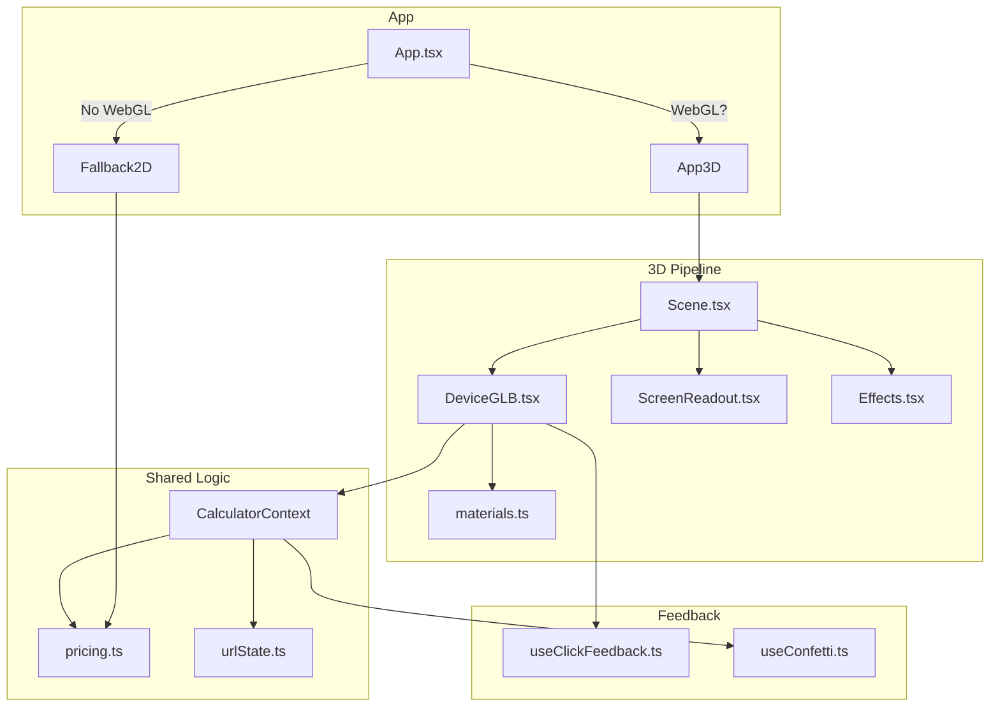

# 🧮 Calculadora 3D — Freelancer Pricing Calculator

[](https://github.com/RobsonMarcolino/Calculadora3D/actions/workflows/deploy.yml)


> 🔗 **[Acesse a demo ao vivo →](https://robsonmarcolino.github.io/Calculadora3D/)**

Uma ferramenta de precificação para designers freelancer, construída como um **dispositivo 3D fotorrealista que você opera de verdade**: gira os knobs, aperta os botões de serviço e vê o display dot-matrix rolar até o preço. Os valores são calibrados para o mercado de design brasileiro.

---

## ✨ Features

| Feature | Descrição |
|---|---|
| 🎮 **Dispositivo 3D interativo** | Modelo GLB fotorrealista com botões, knobs e LEDs animados |
| 🔊 **Feedback tátil** | Sons sintetizados (Web Audio) + vibração haptic em mobile |
| 📊 **Pricing calibrado** | Preços baseados em pesquisa do mercado brasileiro (2025/26) |
| 🎉 **Confetti celebration** | Animação de confetti ao calcular o preço |
| 🔗 **Compartilhar via URL** | Configurações salvas nos parâmetros da URL |
| 📐 **Editor de layout** | Modo `?edit=1` com sliders Leva para ajustar posições |
| 🖥️ **Fallback 2D** | Versão CSS pura entra quando WebGL não está disponível |
| ⏳ **Loading animado** | Tela com barra de progresso durante carregamento do 3D |
| ℹ️ **Metodologia** | Modal com tabela de preços e fontes de pesquisa |

## 🏗️ Arquitetura



## 🛠️ Stack

| Tecnologia | Uso |
|---|---|
| **Vite 6** | Build & dev server |
| **React 18** + **TypeScript** | UI & lógica |
| **React Three Fiber** | Dispositivo 3D (three.js + drei + postprocessing + react-spring) |
| **Tailwind CSS v4** | Estilização |
| **Vitest** | Testes unitários |
| **Blender** | Modelo 3D (`public/models/lbk12c.glb`) |
| **GitHub Actions** | CI/CD (lint, testes, deploy) |
| **GitHub Pages** | Hospedagem da demo |

## 🚀 Rodar localmente

```bash
# Instale as dependências
pnpm install

# Inicie o dev server
pnpm dev        # http://localhost:5173

# Rode os testes
pnpm test
```

> 💡 Adicione `?edit=1` na URL para abrir o editor de layout ao vivo (sliders, gizmos e orbit).

## 📦 Build & Deploy

```bash
pnpm build      # saída estática em dist/
```

O deploy é automático via **GitHub Actions**. Cada push na branch `main`:
1. ✅ Type-check (`tsc --noEmit`)
2. ✅ Testes unitários (`vitest run`)
3. 📦 Build (`vite build`)
4. 🚀 Deploy no GitHub Pages

## 🐳 Docker

```bash
docker build -t lbk-12c .
docker run -p 8080:80 lbk-12c
```

## 📋 Contribuindo

Veja [CONTRIBUTING.md](CONTRIBUTING.md) para setup local, padrões de commit e guidelines.

## 📝 Changelog

Veja [CHANGELOG.md](CHANGELOG.md) para o histórico de mudanças.

---

© 2026 Robson Marcolino Jr
